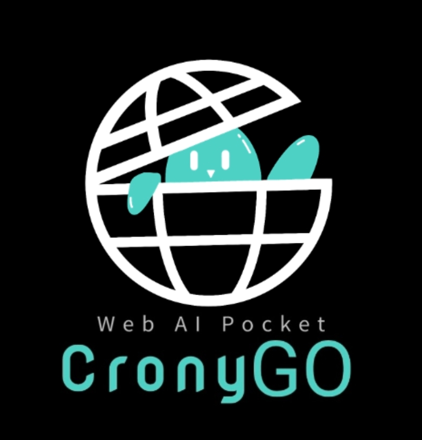

  

# CronyGO AI

**モデルをダウンロードすることで、完全オフラインで動作するAIプラットフォーム。**  
**たとえ宇宙でも、端末が動く限りあなたのそばに居続けます。** 
https://cronygo.vercel.app

---

## 特徴

HTML・CSS・JSのみを使用しているので、Web上で完結します。そのため余計なアプリのダウンロードも必要ありません。ブラウザを使用しますが、サイト自体はオフラインで動作します。加えて、URL経由で簡単に共有でき、スマホでもPCでもどの環境でも動作します。

**プロンプトはどこにも送信されません。プライバシー重視です。**  
**ダウンロードしたモデルは、いくら使っても料金はかかりません。**

---

## 動作テスト済みブラウザ

- Chrome系
- Safari
- （FireFoxはWebLLMなど不安定。ただし、Wllamaは快適）

> ⚠注意:画像認識はChromeでは不安定な場合があります。3以上マルチスレッドで処理した場合が多く、2スレッドまでなら生成可能です。なお、Firefoxは問題なく動作します。

---

## 基本仕様

- **推論エンジン: WebLLM / wllama のツインエンジン構成**
- WebLLM（WebGPUベース）と wllama（llama.cppのWASM実装）を状況に応じて使い分けできます。
- MLC・GGUFに対応した各種モデルをロード可能。

---

## 制作概要

- NewMainブランチでテストしています。
- Vercel でデプロイ＆正式なURLを発行

> ※ **NewMain** ブランチは試験型です。動作確認済み安定版URLを、**Release** ブランチから Vercel にデプロイしています。  
> 制作にはAIを使用しています。

---

## STATUS

**CodeName**

- v.0.1〜 : Legendary Monkey
- 2026年8月23日 v.0.2 完成
- 2026年8月24日 v.0.3 完成
- 次の日 v.0.4 完成
- v.0.5 ライセンス
- v.0.6 音声会話とPWA
- v.0.6+ 音声会話をいろいろ改善。
- v.0.8 チャットルームとか背景変更とかその他諸々。
- v.0.9 Wllamaの制度上げたり色々バグ修整＆軽量モデルもラインナップ。
- v.0.9.5 UIいろいろ改善。意地でも1.0にはしたくない。
- v.0.9.6 WllamaのCPUThread数をいろいろ改善。自動認識可能
- v.0.9.8β ユーザーエクスペリエンスの改善。WebLLMの送信時待機時間など
- v.0.9.8α 停止処理の最適化、ロゴ変更2026/11/10
- v.0.9.8α2 画像認識(VL)モデル対応。生成ログ、再生成、再送信、コピーが可能。会話エクスポート、ファイル転送も追加。
(ここらへんから更新スピード遅くなるかも)

